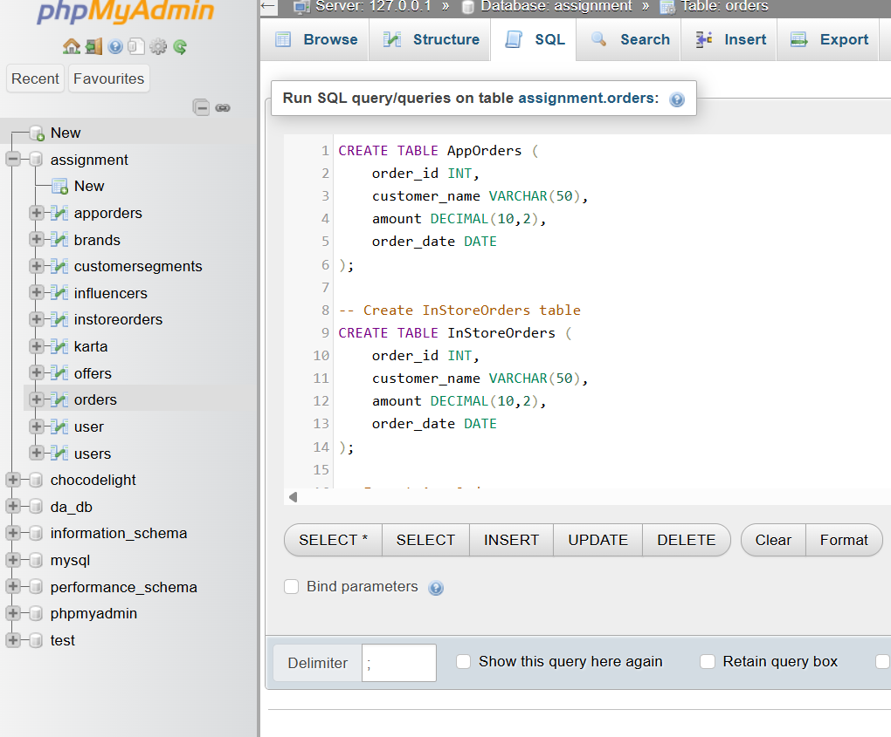

# Create AppOrders table
CREATE TABLE AppOrders (
    order_id INT,
    customer_name VARCHAR(50),
    amount DECIMAL(10,2),
    order_date DATE
);

-- Create InStoreOrders table
CREATE TABLE InStoreOrders (
    order_id INT,
    customer_name VARCHAR(50),
    amount DECIMAL(10,2),
    order_date DATE
);

-- Insert App Orders
INSERT INTO AppOrders VALUES
(1, 'Rahul', 500, '2026-10-01'),
(2, 'Priya', 750, '2026-10-02'),
(3, 'Amit', 600, '2026-10-03');

-- Insert In-Store Orders
INSERT INTO InStoreOrders VALUES
(101, 'Neha', 400, '2026-10-01'),
(102, 'Rahul', 500, '2026-10-02'),
(103, 'Karan', 900, '2026-10-03');

**screenshot**

