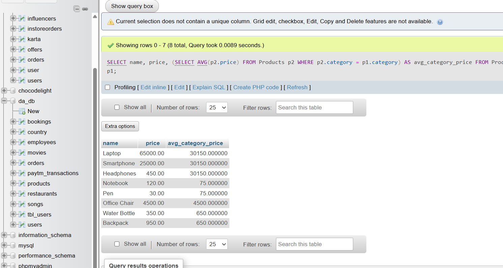

# Show each product with its category average price

SELECT 
    name,
    price,
    (SELECT AVG(p2.price)
     FROM Products p2
     WHERE p2.category = p1.category) AS avg_category_price
FROM Products p1;

**screenshot**
