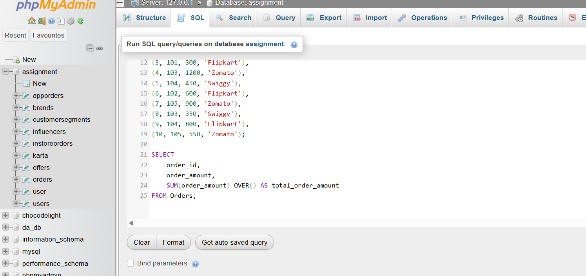

# Create Orders table
CREATE TABLE Orders (
    order_id INT,
    user_id INT,
    order_amount DECIMAL(10,2),
    app_name VARCHAR(50)
);

INSERT INTO Orders VALUES
(1, 101, 500, 'Zomato'),
(2, 102, 750, 'Swiggy'),
(3, 101, 300, 'Flipkart'),
(4, 103, 1200, 'Zomato'),
(5, 104, 450, 'Swiggy'),
(6, 102, 600, 'Flipkart'),
(7, 105, 900, 'Zomato'),
(8, 103, 350, 'Swiggy'),
(9, 104, 800, 'Flipkart'),
(10, 105, 550, 'Zomato');

SELECT 
    order_id,
    order_amount,
    SUM(order_amount) OVER() AS total_order_amount
FROM Orders;

**screenshot**
