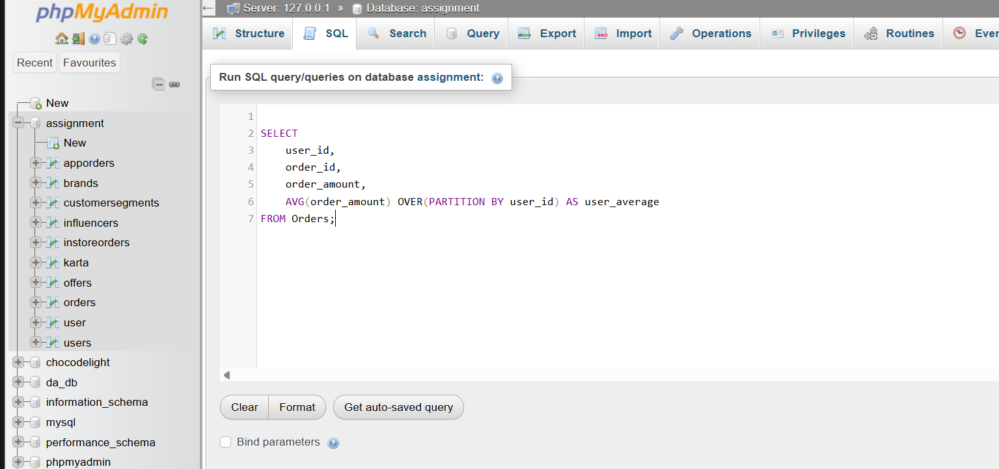

# Show each user's order and average order amount

SELECT 
    user_id,
    order_id,
    order_amount,
    AVG(order_amount) OVER(PARTITION BY user_id) AS user_average
FROM Orders;

**screenshot**
