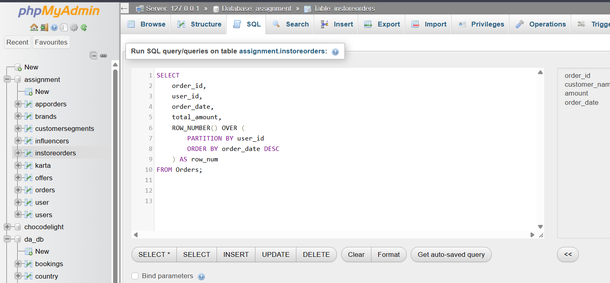

#  Assign row number to each order per user

SELECT 
    order_id,
    user_id,
    order_date,
    total_amount,
    ROW_NUMBER() OVER (
        PARTITION BY user_id
        ORDER BY order_date DESC
    ) AS row_num
FROM Orders;

**screenshot**
