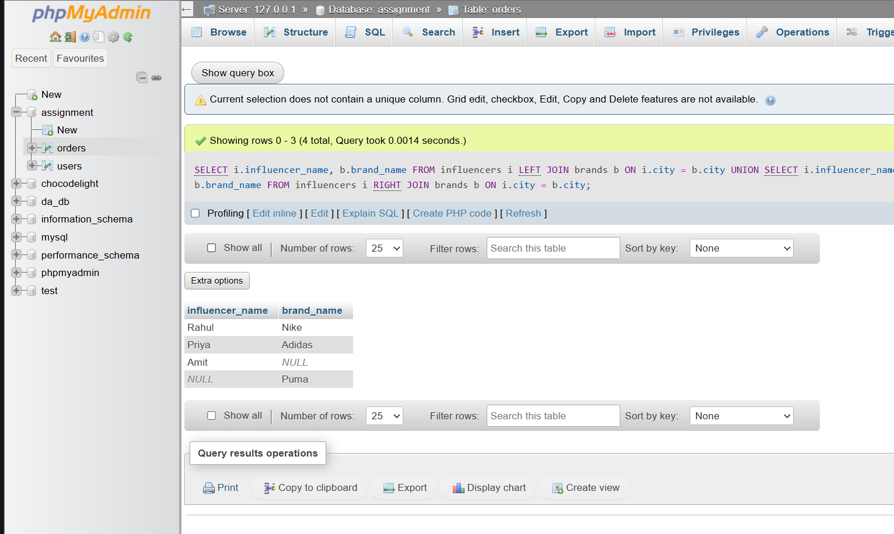

# Show all influencers and brands matched by city

CREATE TABLE influencers (
    id INT PRIMARY KEY,
    influencer_name VARCHAR(50),
    city VARCHAR(50)
);

CREATE TABLE brands (
    id INT PRIMARY KEY,
    brand_name VARCHAR(50),
    city VARCHAR(50)
);

INSERT INTO influencers VALUES
(1, 'Rahul', 'Ahmedabad'),
(2, 'Priya', 'Rajkot'),
(3, 'Amit', 'Surat');

INSERT INTO brands VALUES
(1, 'Nike', 'Ahmedabad'),
(2, 'Puma', 'Mumbai'),
(3, 'Adidas', 'Rajkot');

SELECT i.influencer_name, b.brand_name
FROM influencers i
LEFT JOIN brands b ON i.city = b.city

UNION

SELECT i.influencer_name, b.brand_name
FROM influencers i
RIGHT JOIN brands b ON i.city = b.city;

**screenshot**

